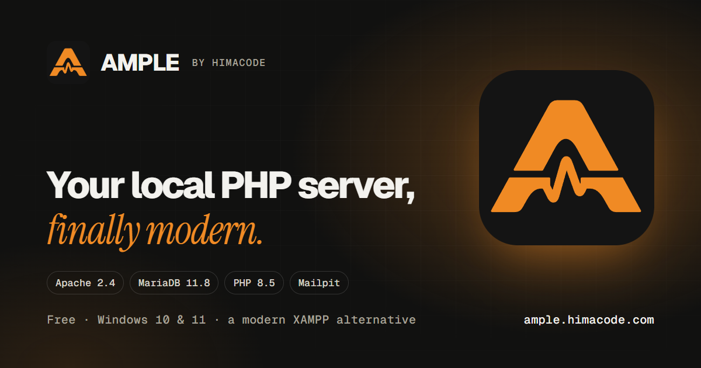
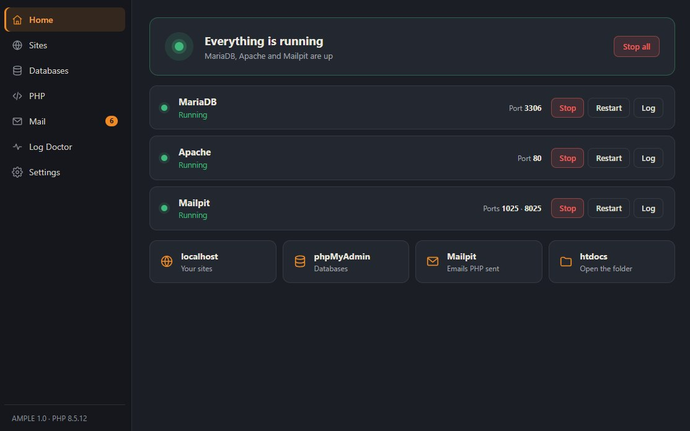
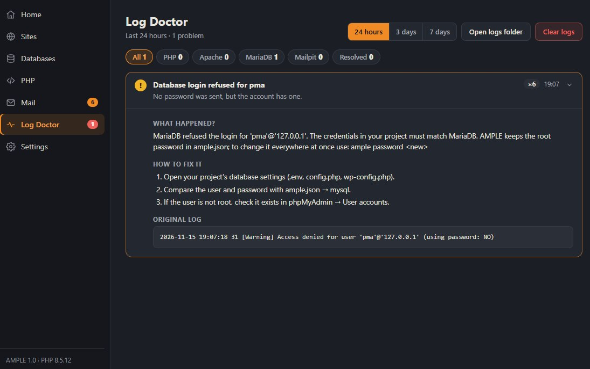
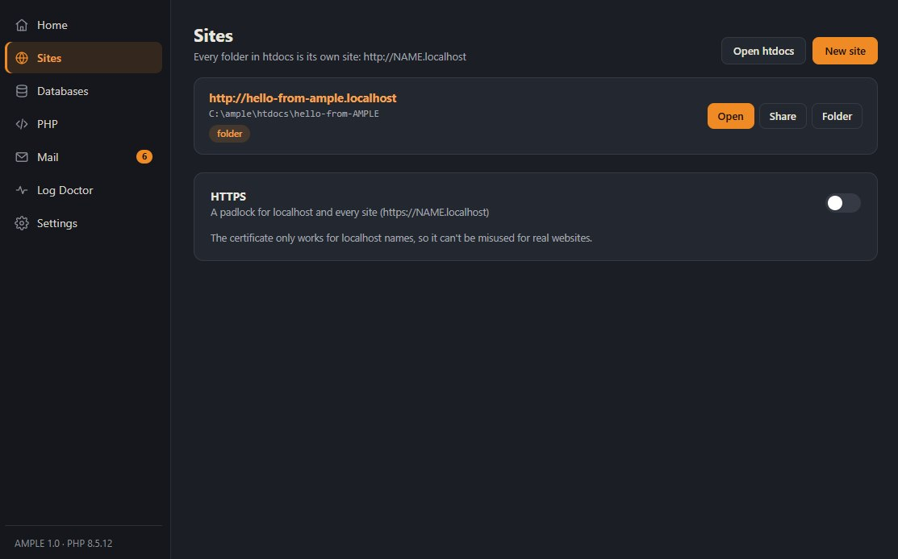
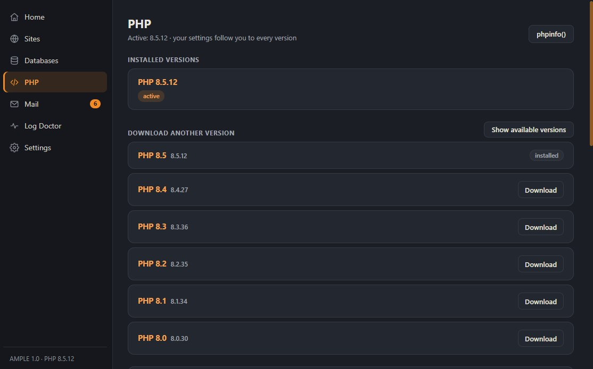
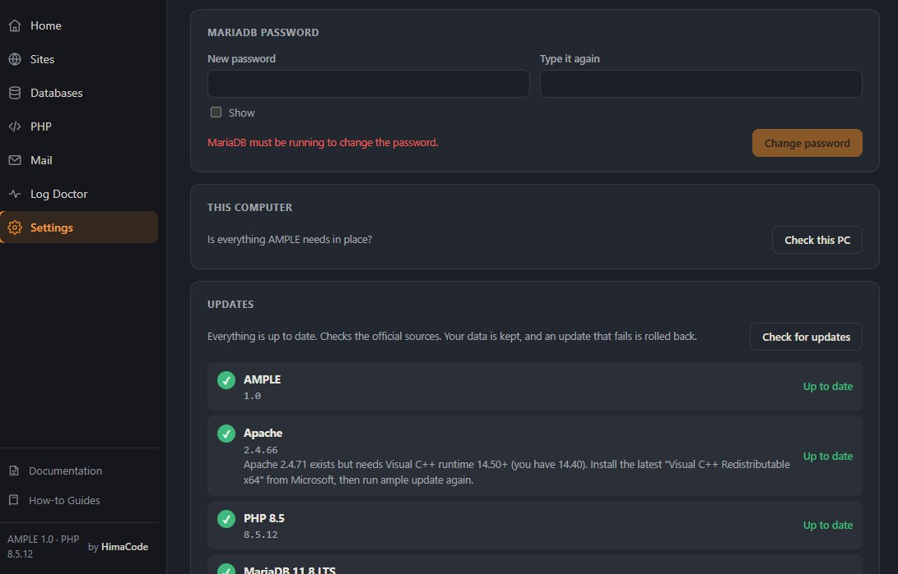
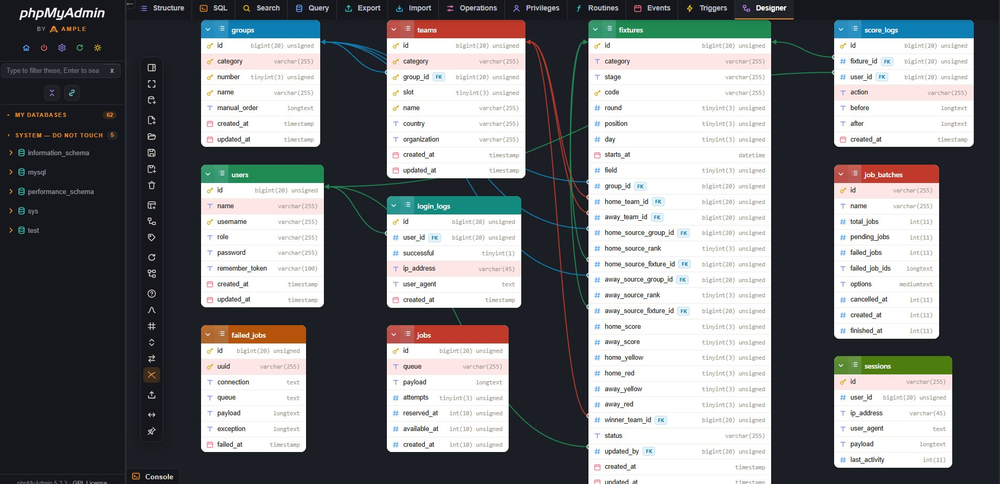
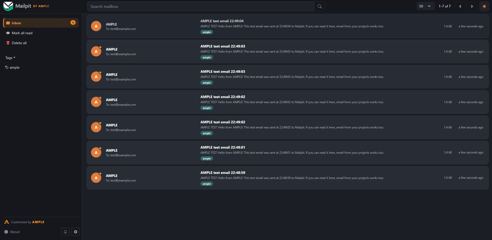

<p align="center">
  <a href="https://ample.himacode.com/">
    
  </a>
</p>

<p align="center">
  <a href="https://ample.himacode.com/download/get.php?v=1.0.1"></a>
  
  
  <a href="LICENSE"></a>
</p>
<p align="center">
  
  
  
  
  
  
</p>

<h3 align="center">A free, modern local PHP server for Windows.</h3>

<p align="center">
  Apache, MariaDB, PHP 8.5, phpMyAdmin, Mailpit and Composer in one installer,<br>
  with a real control panel that tells you what went wrong, and how to fix it.
</p>

<p align="center">
  <a href="https://ample.himacode.com/download/get.php?v=1.0.1"><b>Download</b></a> ·
  <a href="https://ample.himacode.com/">Website</a> ·
  <a href="https://ample.himacode.com/docs/">Docs</a> ·
  <a href="https://ample.himacode.com/guides/">Guides</a> ·
  <a href="https://ample.himacode.com/faq/">FAQ</a> ·
  <a href="https://github.com/himacode-company/AMPLE/issues">Report a bug</a>
</p>

<br>

<p align="center">
  
</p>

---

## Why AMPLE

For more than twenty years, XAMPP was where many of us wrote our first line of PHP. Thank you, XAMPP.
But PHP gets a new version every year, and XAMPP for Windows went **35 months without a release**
(from 21 November 2023 to 23 October 2026). Developers should not have to wait that long.

AMPLE keeps the same idea, one download and everything works, and builds what we always wished we had around it:

| | |
|---|---|
| 🩺 **Log Doctor** | Reads the Apache, PHP and MariaDB logs and explains each problem in plain English or Arabic: what happened, why, and the fix. Often one click fixes it. |
| 🌐 **`NAME.localhost` sites** | Every folder in `htdocs` is its own site at `http://NAME.localhost`, with no hosts file and no admin rights. Laravel's `public\` is served automatically. |
| 🔒 **Local HTTPS** | `https://NAME.localhost` with a local certificate authority that is limited to `localhost`, so it can never be used to fake a real website. |
| 🐘 **PHP versions** | Install another PHP version, compare it, and switch, carrying over your extensions and settings. |
| 🗄️ **Databases, protected** | MariaDB with phpMyAdmin in the AMPLE design, backups, imports of any size, and a rescue mode when MariaDB will not start. |
| ✉️ **Mailpit built in** | Every email your code sends stays on your PC. `mail()` works with no setup. |
| 🔗 **Share a site** | A public link to a local site in one click, through Cloudflare Tunnel. |
| 📦 **Moving from XAMPP** | `ample xampp scan` finds your XAMPP projects, databases and settings and imports them. XAMPP is never touched. |
| 🔄 **Safe updates** | Checked from inside the panel. Every download is verified with SHA-256; your projects and databases are kept, and a failed update rolls back. |
| 🛡️ **Private by default** | Apache, MariaDB and Mailpit only answer this computer (`127.0.0.1`). No admin rights to install or run. |

## Screenshots

<table>
  <tr>
    <td width="50%"><p align="center"><sub><b>Log Doctor</b>: every error, explained</sub></p></td>
    <td width="50%"><p align="center"><sub><b>Sites</b>: every folder at NAME.localhost</sub></p></td>
  </tr>
  <tr>
    <td width="50%"><p align="center"><sub><b>PHP</b>: install and switch versions</sub></p></td>
    <td width="50%"><p align="center"><sub><b>Updates</b>: from inside the panel</sub></p></td>
  </tr>
  <tr>
    <td width="50%"><p align="center"><sub><b>phpMyAdmin</b>, in the AMPLE design</sub></p></td>
    <td width="50%"><p align="center"><sub><b>Mailpit</b>: the emails your code sent</sub></p></td>
  </tr>
</table>

## Install

AMPLE runs on **Windows 10 and Windows 11 (64-bit)**. You do not need administrator rights, and you do not need to install anything first. Pick one of two ways:

### Option 1: the installer (recommended)

1. **[Download AMPLE for Windows](https://ample.himacode.com/download/get.php?v=latest)** (about 105 MB) from ample.himacode.com.
2. Run it and choose a folder: just for you, or for every user of this PC.
3. Open AMPLE and press **Start**. Your first site is on `http://localhost`.

> **Windows says "Smart App Control blocked an app that might be unsafe"?**
> Smart App Control blocks new installers it does not know yet. Download the **[ZIP version](https://ample.himacode.com/download/get.php?v=latest&type=zip)** instead: right-click it, choose **Extract All**, then run `AMPLE-Setup.exe` inside the folder. It is the same setup, and Windows lets it run. You do not need to turn Smart App Control off.

### Option 2: from the source code

```bat
git clone https://github.com/himacode-company/AMPLE.git
cd AMPLE
setup.cmd
```

No Git? Use **Code → Download ZIP**, unzip it, and double-click `setup.cmd`.

`setup.cmd` works on a fresh Windows PC. It:

1. downloads a portable Node.js, only for AMPLE (`control\runtime\`);
2. checks the Visual C++ runtime that Apache and PHP need, and offers Microsoft's installer if it is missing;
3. downloads Apache, PHP, MariaDB, phpMyAdmin, Mailpit and Composer from their official sources;
4. runs `ample check` to make sure this PC is ready;
5. opens the control panel.

Every download is checked against the SHA-256 pinned in [`control/components.json`](control/components.json).

## Quick start

Your projects go in `htdocs`. A folder named `shop` opens at `http://shop.localhost` (and at `http://localhost/shop/`, like XAMPP).

Prefer the terminal? Open one in the AMPLE folder:

```text
ample panel             open the control panel
ample start             start MariaDB, Apache and Mailpit
ample stop              stop them (MariaDB shuts down cleanly)
ample status

ample doctor            explain the problems in the logs (English / Arabic)
ample check             is this PC ready? (Visual C++, Smart App Control, Defender, ports...)

ample php-add 8.4       download another PHP version
ample php-use 8.4       switch, carrying over your extensions and settings
ample https on          https://localhost and https://NAME.localhost
ample backup            export every database to backups\
ample xampp scan        what can be imported from XAMPP (read-only)
ample update            check every component against its official source
```

The full command list, folders and settings are in **[GUIDE.md](GUIDE.md)**, and everything is explained in the **[documentation](https://ample.himacode.com/docs/)**.

## What's inside AMPLE 1.0.1

| Component | Version | What it does |
|---|---|---|
| Apache | 2.4.66 | The web server |
| PHP | 8.5.12 | One folder per version; add more with `ample php-add` |
| MariaDB | 11.8.10 | The database (MySQL-compatible) |
| phpMyAdmin | 5.2.3 | Manage your databases, in the AMPLE design |
| Mailpit | 1.34.0 | Catches every email PHP sends |
| Composer | ✓ | PHP's package manager, ready in any terminal |
| Cloudflare Tunnel | on first share | Downloaded only when you share a site |

## Help and bugs

- **Something is not working?** Run `ample doctor` first: it often knows the answer.
- **Found a bug?** [Open an issue](https://github.com/himacode-company/AMPLE/issues/new). Please include your Windows version, your AMPLE version, and the output of `ample check`.
- **An idea?** Issues are welcome for that too.
- **A security problem?** Please do not open a public issue. Email **ample@himacode.com** instead.

## Contributing

Pull requests are welcome. AMPLE is plain Node.js (no build step for the code itself):

| Folder | What's inside |
|---|---|
| `control/core/` | The engine: services, Log Doctor, updates, sites, HTTPS, XAMPP import |
| `control/cli/` | The `ample` command line |
| `control/panel/` | The control panel (Electron) |
| `control/installer/` | The setup program |
| `control/pma/` | The AMPLE design for phpMyAdmin |
| `control/tools/` | `bootstrap.ps1`, the first-time setup that `setup.cmd` runs |

For a bigger change, please open an issue first so we can talk about it.

## License

AMPLE is free software, released under the **[GNU General Public License v3.0](LICENSE)**.
You may use, study, share and change it; if you share a changed version, it must stay free under the same license.

AMPLE downloads and runs other open-source programs, each under its own license:
Apache HTTP Server (Apache-2.0), PHP (PHP License), MariaDB (GPL-2.0), phpMyAdmin (GPL-2.0),
Mailpit (MIT), Composer (MIT), Node.js (MIT), Electron (MIT) and Cloudflare Tunnel (Apache-2.0).
Thank you to everyone who builds them.

XAMPP is a trademark of Apache Friends. AMPLE is not affiliated with Apache Friends.

---

<p align="center">
  <a href="https://himacode.com/"></a>
</p>
<p align="center">
  Made by <a href="https://himacode.com/"><b>HimaCode</b></a><br>
  <sub><a href="https://ample.himacode.com/">ample.himacode.com</a> · <a href="mailto:ample@himacode.com">ample@himacode.com</a></sub>
</p>
